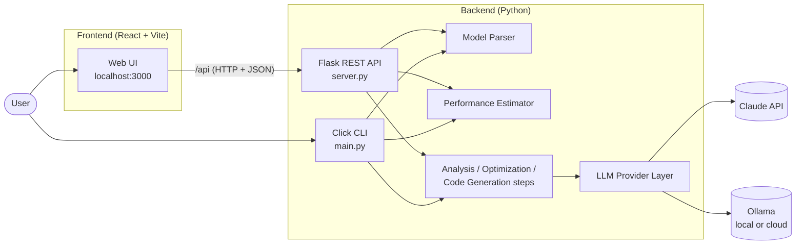
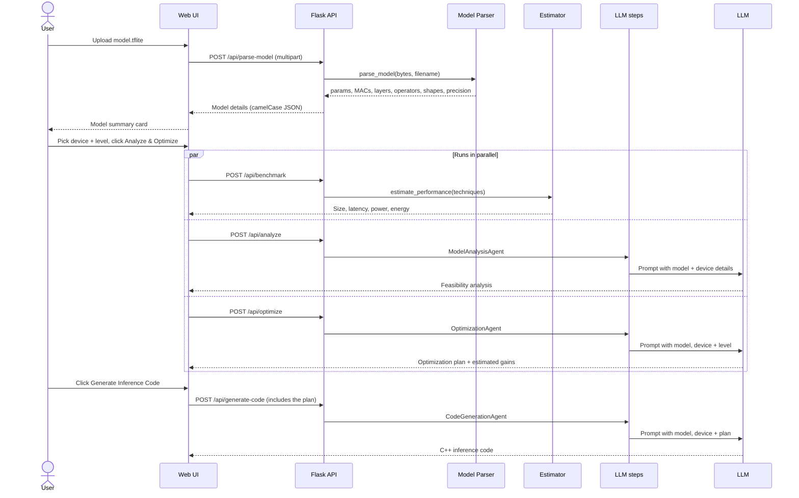
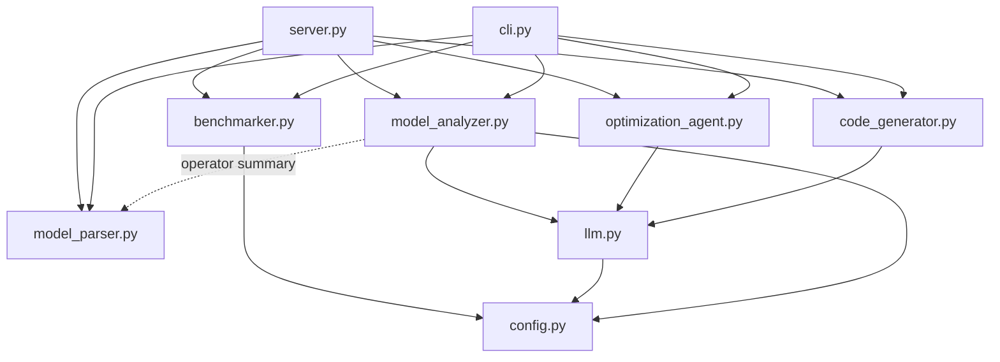
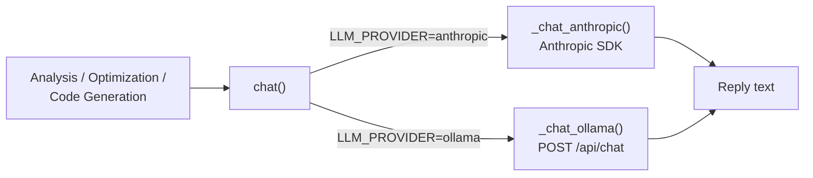
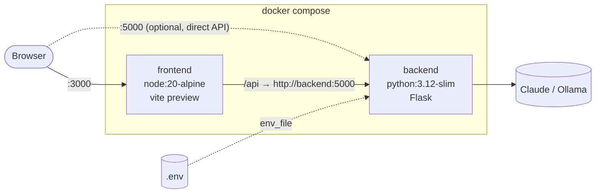

# Architecture

This document explains how EdgeInfer is built: its components, how a request flows through them, and the design decisions behind them.

## Contents

1. [System overview](#1-system-overview)
2. [Request flow](#2-request-flow)
3. [Backend modules](#3-backend-modules)
4. [Model parser](#4-model-parser)
5. [Performance estimator](#5-performance-estimator)
6. [LLM provider layer](#6-llm-provider-layer)
7. [The three LLM steps](#7-the-three-llm-steps)
8. [REST API](#8-rest-api)
9. [Frontend](#9-frontend)
10. [Deployment](#10-deployment)
11. [Testing and CI](#11-testing-and-ci)
12. [Design decisions](#12-design-decisions)
13. [Extending EdgeInfer](#13-extending-edgeinfer)

---

## 1. System overview

EdgeInfer has two entry points (a web UI and a CLI) that share the same Python core.



| Layer | Technology | Responsibility |
|---|---|---|
| Web UI | React 18, TypeScript, Tailwind CSS, Vite | Upload, device and level selection, showing results |
| REST API | Flask, flask-cors | Validates requests, converts data formats, calls the core |
| CLI | Click | Same features in the terminal, plus interactive follow-ups |
| Core | Plain Python modules in `src/` | Parsing, estimating, prompting |
| LLM | Claude (Anthropic SDK) or Ollama (HTTP) | Analysis, planning and code generation text |

The parser and estimator run locally and are deterministic. Only the three text-generation steps call an LLM.

---

## 2. Request flow

A full run in the web UI goes through four stages.



The benchmark returns almost instantly, so users see numbers while the slower LLM calls are still running. Code generation is a separate step because it builds on the optimization plan.

---

## 3. Backend modules

```
src/
├── config.py               # Settings from .env, hardware targets, optimization levels
├── model_parser.py         # Reads .tflite / .onnx files
├── benchmarker.py          # Performance estimator
├── llm.py                  # Claude / Ollama provider layer
├── model_analyzer.py       # LLM step 1: feasibility analysis
├── optimization_agent.py   # LLM step 2: optimization plan
├── code_generator.py       # LLM step 3: inference code
└── cli.py                  # Click commands
server.py                   # Flask REST API
main.py                     # CLI entry point
```



### Model information format

Every module works with one dictionary describing the model. Python uses snake_case, and the API converts it to camelCase for the UI.

| Python (`model_info`) | JSON (`modelInfo`) | Example |
|---|---|---|
| `name` | `name` | `"person_detect"` |
| `framework` | `framework` | `"TensorFlow Lite"` |
| `total_params` | `totalParams` | `210708` |
| `macs` | `macs` | `7157888` |
| `layers` | `layers` | `31` |
| `operators` | `operators` | `{"CONV_2D": 14, "DEPTHWISE_CONV_2D": 14, ...}` |
| `input_shape` | `inputShape` | `(1, 96, 96, 1)` |
| `output_shape` | `outputShape` | `(1, 2)` |
| `precision` | `precision` | `"INT8"` |
| `size_mb` | `sizeMb` | `0.287` |

### Hardware targets

Each device in `Config.HARDWARE_TARGETS` (`src/config.py`) has:

| Field | Meaning |
|---|---|
| `name`, `platform` | Display name and chip family |
| `ram_kb`, `flash_kb` | Memory limits |
| `cpu_mhz` | Clock speed |
| `power_mw` | Typical active power draw |
| `int8_macs_per_cycle`, `float_macs_per_cycle` | Effective throughput with optimized kernels (CMSIS-NN / ESP-NN) |

---

## 4. Model parser

`src/model_parser.py` reads a model file without running it and without TensorFlow or PyTorch installed.

| Format | Library | How it reads the file |
|---|---|---|
| `.tflite` | `tflite` (FlatBuffers schema bindings) | Checks the `TFL3` file identifier, then walks subgraphs, operators, tensors and buffers |
| `.onnx` | `onnx` | Parses the protobuf graph, then runs ONNX shape inference to get every intermediate tensor shape |

What it extracts:

| Field | How it's computed |
|---|---|
| Parameters | Elements in every tensor that holds stored data (TFLite buffers with data, ONNX initializers) |
| MACs | Per layer: dense = outputs × inputs; conv = outputs × kernel height × width × input channels; depthwise conv = outputs × kernel height × width. ONNX: `Conv`, `Gemm` and `MatMul` |
| Layers / operators | Count of each operator type, e.g. `CONV_2D x14` |
| Precision | Data type holding the most weights (`FLOAT32`, `INT8`, ...) |
| Shapes | First graph input and output. Dynamic dimensions are shown as `-1` (`?` in the UI) |

Errors (wrong extension, missing `TFL3` identifier, corrupted protobuf, empty graph) raise `ModelParseError`, which the API turns into a `400` with a readable message.

Checked against TensorFlow's person-detection model (MobileNet v1 0.25, 96×96): 210,708 parameters, 7.16M MACs, 31 layers, INT8.

---

## 5. Performance estimator

`src/benchmarker.py` turns model details plus a device into estimates. It runs locally with no LLM call.

**Latency**

```
cycles     = MACs / macs_per_cycle  +  layers × 2000
latency_ms = cycles / (cpu_mhz × 1000)  ×  pruning factor  ×  fusion factor
```

- `macs_per_cycle` is the device's INT8 throughput if the model is already INT8 or is being quantized, otherwise its float throughput.
- `2000` cycles per layer approximates interpreter overhead (dispatch and tensor bookkeeping).
- Pruning multiplies latency by 0.85 and fusion by 0.9.
- If MACs are unknown, the parameter count is used instead (exact for dense layers).

**Other estimates**

| Estimate | Rule |
|---|---|
| Size | Quantization × 0.25 (FP32 → INT8), pruning × 0.75. Already-INT8 models are not quantized again |
| Accuracy kept | −2% for quantization, −1% for pruning |
| Power | Device's active power while running |
| Energy per inference | Power × latency |
| Fits in memory | Optimized size < device Flash |
| Deployment ready | Fits in Flash and latency under 5 seconds |

Example estimates for the person-detection model (7.2M MACs, INT8):

| Device | Latency | Energy |
|---|---|---|
| Cortex-M7 (216 MHz) | 56 ms | 8.3 mJ |
| ESP32-S3 (240 MHz, vector unit) | 60 ms | 5.4 mJ |
| ESP32 (240 MHz) | 299 ms | 23.9 mJ |
| Arduino Nano 33 (64 MHz) | 374 ms | 15.0 mJ |
| Raspberry Pi Pico (125 MHz, Cortex-M0+) | 955 ms | 47.7 mJ |

These are rough estimates for comparing devices and options. They are not measurements.

---

## 6. LLM provider layer

`src/llm.py` exposes one function used by all three LLM steps:

```python
chat(system: str, messages: list, max_tokens: int = 16000) -> str
```



| | Claude | Ollama |
|---|---|---|
| Transport | Official `anthropic` Python SDK | `requests` POST to `{OLLAMA_BASE_URL}/api/chat` |
| Model | `MODEL` (default `claude-opus-5-5`) | `OLLAMA_MODEL` (default `gemma4:31b`) |
| Auth | `ANTHROPIC_API_KEY` | `Authorization: Bearer OLLAMA_API_KEY` (cloud only) |
| Extras | Reasoning `EFFORT`; automatic fallback to another model if a request is declined | 300-second timeout for long code generation |
| Reply handling | Keeps only text blocks (skips thinking blocks) | Uses `message.content` |

Both providers report truncated replies with a visible note and turn every failure (bad key, unreachable server, API error, refusal) into an `LLMError` with a readable message. The API returns these as `502`, and the CLI prints them without a stack trace.

---

## 7. The three LLM steps

Each step is a small class that builds a prompt from the model and device details and keeps the conversation history, so the CLI can ask follow-up questions.

| Step | Class | Input | Output | CLI follow-up |
|---|---|---|---|---|
| 1. Analysis | `ModelAnalysisAgent` | Model, device | Feasibility, memory breakdown, latency, recommendations | `ask_about_model()` |
| 2. Optimization | `OptimizationAgent` | Model, device, level | Prioritized techniques, trade-offs, expected results | `refine_optimization()` |
| 3. Code generation | `CodeGenerationAgent` | Model, device, plan from step 2 | C++ for TensorFlow Lite Micro, integration notes | `generate_integration_example()` |

Every prompt includes the parsed parameters, MACs, layers, precision and operator list, plus the device's RAM, Flash, clock speed and platform. The operator list matters for step 3, because TensorFlow Lite Micro code must register every operator the model uses.

---

## 8. REST API

All endpoints are under `/api`. Errors always return `{"error": "<message>"}`.

| Method | Endpoint | Request | Response |
|---|---|---|---|
| GET | `/hardware-targets` | none | Map of device key → `{name, ramKb, flashKb, cpuMhz, powerMw}` |
| POST | `/parse-model` | Multipart form with a `file` field | Model details (see section 3) |
| POST | `/benchmark` | `{modelInfo, hardware, level}` or `{modelInfo, hardware, techniques: [...]}` | Size, latency, power, energy, accuracy, `memoryAvailable`, `deploymentReady` |
| POST | `/analyze` | `{modelInfo, hardware}` | `{analysis, metrics, targetHardware}` |
| POST | `/optimize` | `{modelInfo, hardware, level}` | `{plan, level, techniques, estimatedSizeReduction, estimatedLatencyImprovement}` |
| POST | `/generate-code` | `{modelInfo, hardware, optimizationPlan: {plan}}` | `{code, language, hardware}` |

| Status | When |
|---|---|
| `400` | Missing `modelInfo` or file, unknown device or level, invalid or unsupported model file |
| `413` | Upload larger than 200 MB |
| `502` | The LLM call failed (bad key, provider unreachable, refusal) |

Example:

```bash
curl -F "file=@examples/sample-models/hello_world_int8.tflite" http://localhost:5000/api/parse-model
```
```json
{
  "name": "hello_world_int8",
  "framework": "TensorFlow Lite",
  "totalParams": 321,
  "macs": 288,
  "layers": 3,
  "operators": {"FULLY_CONNECTED": 3},
  "inputShape": [1, 1],
  "outputShape": [1, 1],
  "precision": "INT8",
  "sizeMb": 0.0026,
  "type": "Neural Network"
}
```

---

## 9. Frontend

```
client/src/
├── App.tsx                     # State and workflow
├── services/api.ts             # Axios client for every endpoint
├── types/index.ts              # TypeScript types matching the API
└── components/
    ├── Header.tsx
    ├── ModelUpload.tsx         # Drag-and-drop upload
    ├── ModelSummary.tsx        # Parsed model details
    ├── HardwareSelector.tsx    # Device cards
    ├── OptimizationSelector.tsx
    ├── ResultsDisplay.tsx      # Performance estimate cards
    └── AgentOutput.tsx         # LLM output panel with loading state and download
```

- **State** lives in `App.tsx` with React hooks: the parsed model, selections, each result, a loading flag per step, and a list of errors.
- **Parallel requests:** Analyze & Optimize fires the benchmark, analysis and optimization requests together, and each panel fills in as its response arrives.
- **Errors** from any step appear in a red banner with the backend's message. The app never shows made-up results.
- **Stale results** are cleared whenever the model, device or level changes.
- **API address:** requests go to `/api` on the same origin. The Vite dev and preview servers proxy `/api` to the backend (`API_PROXY_TARGET`, default `http://localhost:5000`). `VITE_API_URL` can point the UI at a different API.

---

## 10. Deployment



| Service | Image | Build | Runs |
|---|---|---|---|
| `backend` | `python:3.12-slim` | Installs `requirements.txt`, copies `main.py`, `server.py` and `src/` | `flask run` on port 5000 |
| `frontend` | `node:20-alpine` | `npm install`, then `npm run build` (type-check + bundle) | `vite preview` on port 3000 |

- `.env` is passed to the backend at runtime with `env_file`. It is excluded from the image by `.dockerignore`, so keys never end up inside an image.
- The frontend reaches the backend by its Compose service name (`API_PROXY_TARGET=http://backend:5000`).
- The backend currently uses Flask's development server, which prints a warning. That's fine locally, but a public deployment should use a production server such as Gunicorn.

---

## 11. Testing and CI

```
tests/
├── conftest.py             # Isolates tests from .env; shared model fixture
├── test_model_parser.py    # Real sample models, generated ONNX graphs, invalid files
├── test_benchmarker.py     # Latency, size, power, energy and deployment rules
├── test_llm.py             # Claude and Ollama request building and error handling
└── test_server.py          # Every endpoint: validation, responses, LLM failures
```

- **No real LLM calls:** tests replace `chat()` or the HTTP/SDK client with fakes. They need no key or network and run in about a second.
- **Real model files:** parser tests use the sample TFLite models in `examples/sample-models/`, plus ONNX graphs built in memory with `onnx.helper`.
- **CI:** `.github/workflows/ci.yml` runs on every push and pull request to `main`:
  - backend tests on Python 3.10 and 3.13;
  - frontend type-check and production build on Node 20.

---

## 12. Design decisions

| Decision | Why |
|---|---|
| **Deterministic parsing and estimating, LLM only for text** | Numbers like parameter counts and latency must be repeatable and testable. The LLM adds value where judgment and explanation are needed. |
| **Real model details in every prompt** | Grounding the LLM in measured facts (MACs, precision, operators) prevents generic or wrong advice. For example, it won't suggest quantizing an INT8 model again. |
| **One `chat()` function for all providers** | The three steps don't know which LLM is behind them. Switching provider is one `.env` setting, and the steps can be tested with a single fake. |
| **Lightweight parsing libraries** | Reading FlatBuffers and protobuf directly avoids installing TensorFlow or PyTorch (gigabytes), keeping the Docker image and CI fast. |
| **Throughput values in config** | All device assumptions live in one place, so they're easy to review and calibrate against real measurements. |
| **Benchmark returned separately from LLM calls** | Users see useful numbers instantly instead of waiting for the slowest response. |
| **Errors instead of fallback data** | Showing invented numbers when something fails would be misleading. Every error carries a message a user can act on. |

---

## 13. Extending EdgeInfer

**Add a device:** add an entry to `HARDWARE_TARGETS` in `src/config.py` with all the fields from [section 3](#hardware-targets). It appears in the UI and CLI automatically.

**Add an LLM provider:** add a `_chat_<provider>()` function in `src/llm.py`, a branch in `chat()`, and its settings in `src/config.py` and `.env.example`.

**Add a model format:** add a `_parse_<format>()` function in `src/model_parser.py` that returns the same dictionary as `_summary()`, register its extension in `SUPPORTED_EXTENSIONS` and `parse_model()`, and update the `accept` list in `client/src/components/ModelUpload.tsx`.

**Add an optimization technique:** add its size, latency and accuracy factors in `Benchmarker.estimate_performance()` (`src/benchmarker.py`), enable it for the relevant levels in `OPTIMIZATION_LEVELS` (`src/config.py`), and add its name to `_techniques_for_level()` in `server.py`.
