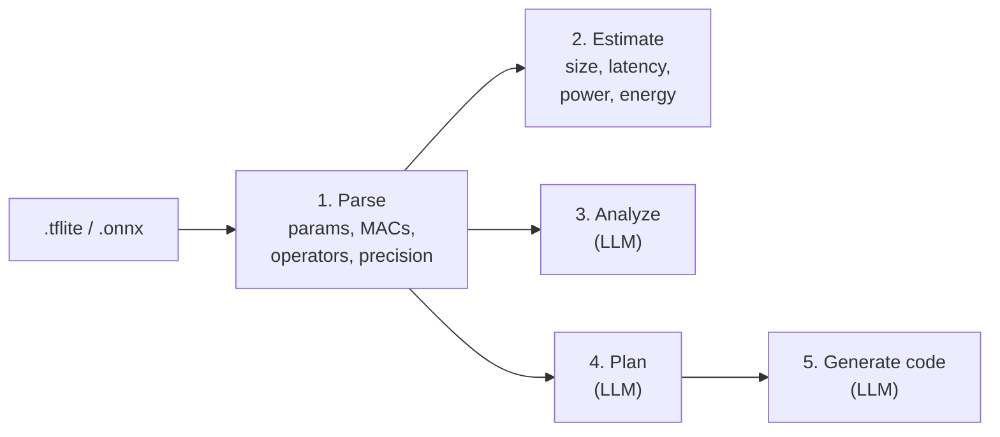
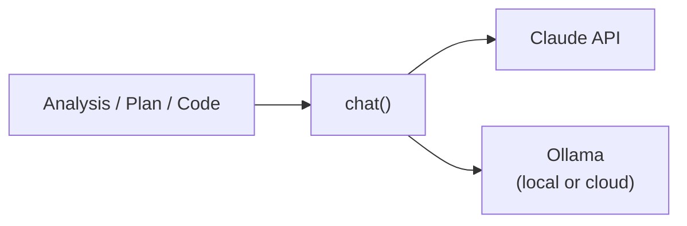
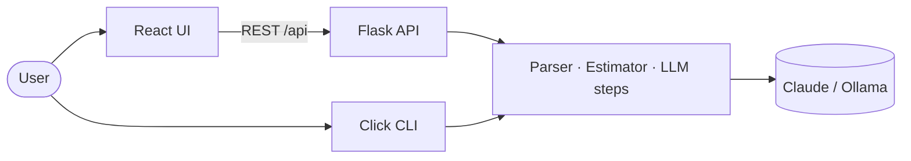

# EdgeInfer: Project Overview

**Deploying AI models to microcontrollers, with an LLM as your embedded ML expert.**

This document explains the whole project as a short presentation. Each section is one "slide" with the key points, followed by speaker notes you can use when presenting it in an interview or demo.

| | |
|---|---|
| **What** | A tool that reads a neural network, checks whether it can run on a microcontroller, plans how to shrink it, and writes the C++ code to deploy it |
| **Who it's for** | Embedded and IoT developers putting ML on devices like the ESP32, STM32 or Raspberry Pi Pico |
| **Built with** | Python, Flask, React, TypeScript, Docker, Claude / Ollama |
| **Author** | Salman Khan |

---

## Slide 1: The problem

**Running AI on tiny devices is hard.**

- Microcontrollers have **kilobytes** of memory: an ESP32 has 520 KB of RAM and 4 MB of Flash. A typical image model is 14 MB.
- Developers have to answer difficult questions before writing any code:
  - Will this model fit? How fast will it run on this chip?
  - Should I quantize it? Prune it? Which one helps more?
  - How do I write the TensorFlow Lite Micro code for this exact model?
- The answers depend on both the model and the chip, and the expertise is specialized.

> **Speaker notes:** Start with a concrete example: "I have an image model, and I want it on an ESP32 camera board. Before I write one line of code, I need to know if it fits, how slow it'll be, and how to shrink it." That's hours of research and trial and error for someone who isn't an embedded ML specialist.

---

## Slide 2: The solution

**EdgeInfer answers those questions in under a minute.**

1. **Upload** a `.tflite` or `.onnx` model.
2. **Pick** a target device and an optimization level.
3. **Get:**
   - the model's real architecture (parameters, compute, layers, precision);
   - instant performance estimates for that device;
   - an expert feasibility analysis;
   - a step-by-step optimization plan;
   - ready-to-adapt C++ inference code.

Available as a **web app** and a **command-line tool**.

> **Speaker notes:** The key idea is combining two kinds of intelligence. Hard facts come from reading the model file and doing the math: parameters, MACs, estimated latency. Judgment and explanation come from an LLM: what to optimize, what the risks are, and how the code should look. The LLM never makes up the numbers; it's given them.

---

## Slide 3: Live demo

**Script (about 3 minutes):**

1. Open http://localhost:3000.
2. Drag in `examples/sample-models/hello_world_int8.tflite`.
   - *Point out:* 321 parameters, 288 MACs, INT8, 3 fully connected layers, all read from the file.
3. Select **Arduino Nano 33**, keep **Balanced**, click **Analyze & Optimize**.
   - *Point out:* the estimates appear instantly; the analysis and plan arrive a few seconds later.
   - *Point out:* the analysis typically does its memory math with the real numbers, e.g. "321 parameters × 1 byte". LLM wording varies from run to run.
4. Switch to **Raspberry Pi Pico** and run it again to show the estimates change with the chip.
5. Click **Generate Inference Code** and show the C++ output and the **Download** button.
6. Optional: run the same flow in the terminal:
   ```bash
   python main.py analyze --model examples/sample-models/hello_world_int8.tflite --hardware esp32
   ```

> **Speaker notes:** If the network or LLM is slow, the benchmark still shows instantly, which is a good moment to explain why those two are separate. Have the app already running in Docker before the demo starts.

---

## Slide 4: How it works



| Step | Runs | Output |
|---|---|---|
| 1. Parse | Locally, deterministic | What the model is |
| 2. Estimate | Locally, deterministic | How it will perform on the chosen device |
| 3. Analyze | LLM | Can it be deployed, and what's the bottleneck? |
| 4. Plan | LLM | How to shrink and speed it up |
| 5. Generate | LLM, using the plan | C++ for TensorFlow Lite Micro |

> **Speaker notes:** Steps 1 and 2 are pure engineering and are fully unit-tested. Steps 3 to 5 are prompts that include everything from steps 1 and 2 plus the device's specs. Code generation receives the optimization plan, so the code matches the strategy.

---

## Slide 5: Reading model files

**No TensorFlow or PyTorch needed.**

- `.tflite` files are FlatBuffers. EdgeInfer reads their structure directly: subgraphs, operators, tensors and weight buffers.
- `.onnx` files are protobuf graphs. EdgeInfer uses ONNX shape inference to learn every layer's tensor shapes.
- From that it computes:
  - **parameters:** every stored weight;
  - **MACs:** multiply-accumulate operations per inference, for dense and convolution layers;
  - **operators:** e.g. `CONV_2D ×14, DEPTHWISE_CONV_2D ×14`;
  - **precision:** FLOAT32 or INT8.

**Verified on TensorFlow's person-detection model:** 210,708 parameters, 7.16 million MACs, 31 layers, INT8.

> **Speaker notes:** Avoiding TensorFlow and PyTorch was a deliberate choice. They're gigabytes of dependencies just to read a file. The lightweight readers keep the Docker image small and CI fast. MACs are the important number, because they decide latency much more than file size does.

---

## Slide 6: Estimating performance

**Same model, different chips:**

```
latency = MACs ÷ (clock speed × MACs per cycle) + per-layer overhead
```

| Device | Person-detection latency | Why |
|---|---|---|
| Cortex-M7, 216 MHz | ~56 ms | Fast core with DSP instructions |
| ESP32-S3, 240 MHz | ~60 ms | Vector unit accelerates INT8 |
| ESP32, 240 MHz | ~299 ms | Same clock, no vector unit |
| Arduino Nano 33, 64 MHz | ~374 ms | Low clock speed |
| Raspberry Pi Pico, 125 MHz | ~955 ms | Cortex-M0+, no DSP |

- Quantizing a float model switches it to the chip's faster INT8 throughput.
- It also reports energy per inference (important for battery devices) and whether the model fits in Flash.

> **Speaker notes:** Be upfront that these are estimates, not measurements. The throughput figures are rough, conservative values kept in one config file so they can be calibrated against real boards. The value is in comparing options: "the S3 is about 5× faster than the plain ESP32 for this model" is a useful decision even if the absolute number is off.

---

## Slide 7: The LLM layer

**Bring your own model: Claude or Ollama.**



- One `chat()` function serves all three steps. Switching provider is a single `.env` setting.
- **Claude:** official Anthropic SDK, configurable model and reasoning effort, automatic fallback if a request is declined.
- **Ollama:** works with free local models or Ollama Cloud (e.g. Gemma).
- Every failure (bad key, server down, refusal) becomes a clear message, never a crash.

> **Speaker notes:** Supporting a local model matters for companies that can't send their models to an external API. The abstraction also made testing easy: one fake `chat()` replaces the LLM in every test.

---

## Slide 8: Architecture



| Part | Technology |
|---|---|
| Frontend | React 18, TypeScript, Tailwind CSS, Vite |
| Backend | Python 3.10+, Flask REST API, Click CLI |
| Model parsing | `tflite` FlatBuffers bindings, `onnx` |
| LLM | Anthropic SDK, Ollama HTTP API |
| Packaging | Docker, Docker Compose |
| Quality | pytest, GitHub Actions CI |

Full details: [ARCHITECTURE.md](ARCHITECTURE.md).

> **Speaker notes:** The web UI and the CLI share the same Python core, so every feature works in both. The API converts between Python's snake_case and the frontend's camelCase at a single boundary.

---

## Slide 9: Engineering quality

- **68 automated tests** covering the parser (with real model files), the estimator, both LLM providers and every API endpoint.
- **No API key needed for tests:** all LLM calls are mocked, and the suite runs in about a second.
- **CI on every push:** tests on Python 3.10 and 3.13, plus a type-check and production build of the frontend.
- **One-command setup** with Docker Compose. Secrets stay in `.env` and never enter the image or the repo.
- **Honest outputs:** the app shows clear errors instead of fake results, and the README lists the limitations.

> **Speaker notes:** Point at the green CI badge on the README. Mention that testing with real model files exposed issues that are now covered by tests: for example, an already-INT8 model was being "quantized" a second time and shown as 75% smaller.

---

## Slide 10: Challenges and decisions

| Challenge | Decision |
|---|---|
| LLMs can invent numbers | Compute all numbers deterministically and give them to the LLM as facts |
| Heavy ML frameworks just to read a file | Read FlatBuffers and protobuf directly with lightweight libraries |
| Latency was originally the same for every device | Model compute (MACs) plus per-device INT8/float throughput |
| Already-quantized models looked like they could shrink 75% more | Detect INT8 precision and skip re-quantizing |
| LLM calls take seconds | Return the instant estimate separately, and run the LLM calls in parallel |
| Different users have different LLM access | Provider layer supporting Claude and local or cloud Ollama |

> **Speaker notes:** Interviewers often ask "what was hard?" The first row is the best story: the core design principle is that the LLM explains and advises, but doesn't calculate.

---

## Slide 11: Limitations and roadmap

**Current limitations**
- Supports `.tflite` and `.onnx` only. Other formats must be converted first.
- Performance numbers are estimates. Nothing is measured on real hardware yet.
- Checks Flash but not yet peak RAM (the TensorFlow Lite Micro tensor arena).
- The API has no authentication, so it isn't ready for public hosting yet.

**Next steps**
- Peak RAM estimate and RAM fit check
- Calibrate device throughput against real boards
- Production server (Gunicorn), authentication and rate limiting
- Formatted Markdown output and follow-up questions in the web UI

> **Speaker notes:** Being clear about limitations shows you understand the problem deeply. The RAM check is the most valuable next feature, because RAM, not Flash, is often what actually blocks a deployment.

---

## Slide 12: Summary

**EdgeInfer turns "Can this model run on my chip?" from hours of research into a one-minute answer.**

- Reads real `.tflite` and `.onnx` models.
- Estimates performance per device from the model's actual compute.
- Uses an LLM for analysis, planning and C++ code, grounded in real numbers.
- Web app and CLI, Claude or Ollama, Docker, tests and CI.

**Try it:** see [GETTING_STARTED.md](GETTING_STARTED.md) and run `docker compose up -d --build`.

> **Speaker notes:** End by offering to show the code for any part. Good candidates are the parser's MAC counting (`src/model_parser.py`), the latency formula (`src/benchmarker.py`) or the provider layer (`src/llm.py`).
